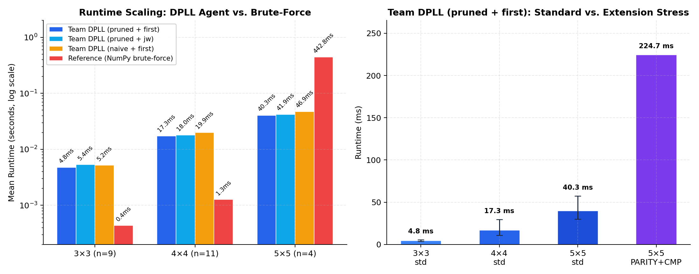
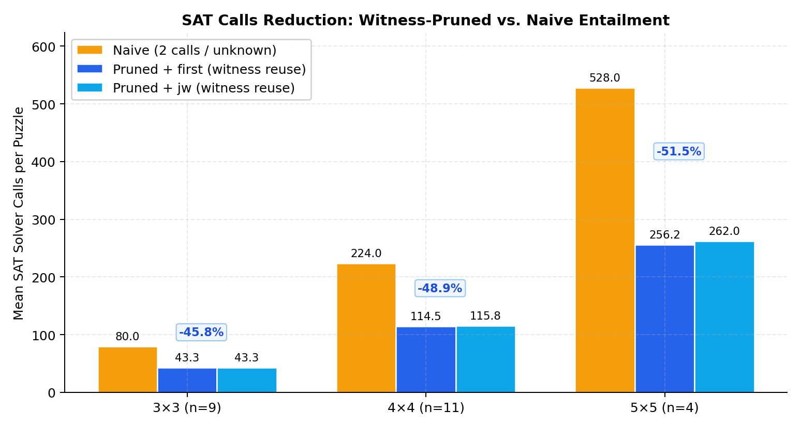
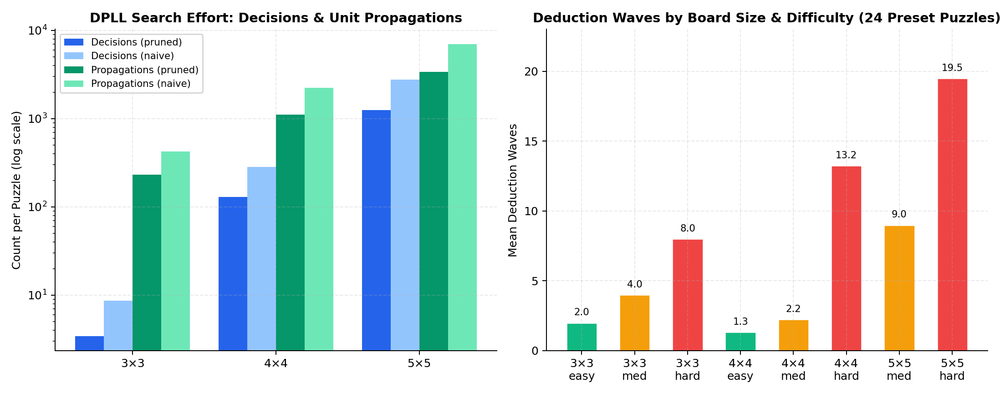
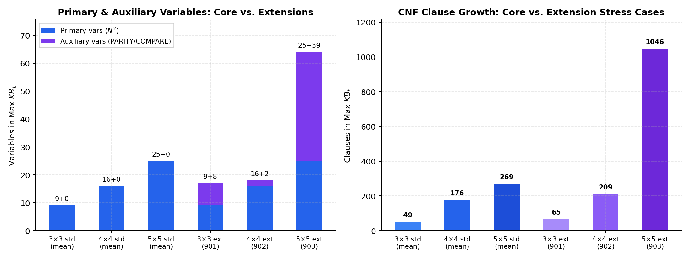

# Báo cáo Phần D: Thiết kế Bộ Puzzle, Kiểm chứng & Thực nghiệm (Experiments)

**Môn học:** CSC14003 - Nhập môn Trí tuệ Nhân tạo  
**Đồ án:** Griductive Solver  
**Người thực hiện:** Thành viên phụ trách Phần D (Puzzle + Thực nghiệm)

---

## 1. Mục tiêu & Thiết lập Thực nghiệm

Phần thực nghiệm nhằm đánh giá toàn diện hệ thống **Griductive Solver** (kết hợp CNF Encoder của Phần A và DPLL Deductive Agent của Phần B) trên cùng một bộ puzzle chuẩn gồm 3 kích thước lưới **3×3**, **4×4**, và **5×5 (stress case)**, đồng thời kiểm chứng tính hợp lệ, tính duy nhất nghiệm và hành vi của hệ thống trong các tình huống mở rộng (`PARITY`, `COMPARE`), thất bại (`STUCK`, `INCONSISTENT`) và quá thời gian (`TIMEOUT`).

### 1.1. Môi trường thực nghiệm
- **Hệ điều hành:** Windows 11 (AMD64)
- **Ngôn ngữ & Thư viện:** Python 3.13.1, NumPy 2.2.4, Matplotlib 3.10.1
- **Công cụ đo đạc:** `tools/benchmark.py` — chạy mỗi puzzle trong một tiến trình con độc lập (`multiprocessing.Process`) với giới hạn thời gian `--timeout 60` giây nhằm cô lập lỗi và ghi nhận đầy đủ các trạng thái `OK` / `FAIL` / `ERROR` / `TIMEOUT`.
- **Phương pháp lấy thời gian:** Mỗi cấu hình DPLL được chạy **3 lần** (`--repeats 3`) và ghi nhận **trung vị (median)** thời gian chạy `runtime_s` để giảm nhiễu hệ thống. Cấu hình đối chứng brute-force (`reference`) chạy 1 lần mỗi puzzle.

### 1.2. Sáu nhóm chỉ số đánh giá
Mọi lượt chạy benchmark đều ghi nhận đầy đủ 6 nhóm chỉ số theo yêu cầu đồ án:
1. **Số biến chính / biến phụ (`Prim.` / `Aux.`):** Kích thước biến mệnh đề sơ cấp ($N^2$) và biến phụ trợ ($> N^2$) tại trạng thái $KB_t$ lớn nhất trong quá trình giải.
2. **Số mệnh đề CNF (`Clauses`):** Số lượng mệnh đề lớn nhất trong $KB_t$.
3. **Số lời gọi SAT (`SAT calls`):** Tổng số lần agent truy vấn bộ giải DPLL trong toàn bộ ván chơi.
4. **Nỗ lực tìm kiếm DPLL (`Dec.` / `Prop.` / `BT`):** Tổng số lần rẽ nhánh (*decisions*), lan truyền đơn vị (*unit propagations*) và quay lui (*backtracks*).
5. **Số bước & số đợt suy diễn (`Steps` / `Waves`):** Tổng số nhân vật agent tự suy luận ra và số đợt (*waves*) — một đợt mới bắt đầu khi toàn bộ các nhân vật bị ép từ đầu đợt trước đã được lật mở.
6. **Thời gian thực thi (`Time (s)`):** Thời gian chạy thực tế của vòng lặp suy luận (trung vị qua 3 lần chạy).

---

## 2. Bộ Puzzle & Kiểm chứng Tính Duy nhất Nghiệm (`verify_puzzles.py`)

### 2.1. Cấu trúc bộ dữ liệu chính thức (`puzzles/`)
Bộ dữ liệu benchmark chuẩn gồm **24 puzzle** được sinh tất định bởi `tools/generate_puzzles.py --preset`:
- **3×3 (9 bài):** 3 `easy`, 3 `medium`, 3 `hard` (1 ô mở ban đầu, 8 bước suy luận).
- **4×4 (11 bài):** 3 `easy`, 4 `medium`, 4 `hard` (2 ô mở ban đầu, 14 bước suy luận).
- **5×5 — stress case (4 bài):** 2 `medium`, 2 `hard` (3 ô mở ban đầu, 22 bước suy luận).

### 2.2. Kết quả kiểm chứng hai lớp độc lập
Toàn bộ 24 puzzle trong `puzzles/` đã được kiểm tra lại bằng cả **hai bộ kiểm chứng độc lập**:

| Phương pháp kiểm chứng | Lệnh thực thi | Phạm vi | Kết quả |
|---|---|---|---|
| **Brute-force độc lập (Phần D)** | `python tools/verify_puzzles.py` | 24/24 file trong `puzzles/` | **24/24 OK** — `models = 1`, mọi clue đúng dưới `solution`, vòng lặp không đoán giải hoàn tất, khớp `meta.reveal_order` |
| **DPLL + Blocking Clause (Phần B)** | `src.agent.uniqueness.check_puzzle_uniqueness` | 24/24 file trong `puzzles/` | **24/24 UNIQUE** — đúng 1 mô hình duy nhất và khớp 100% với `solution` |

---

## 3. Kết quả Benchmark Chính thức

### 3.1. So sánh tổng hợp giữa các cấu hình theo kích thước lưới (toàn bộ 24 puzzle)

Để đánh giá hiệu quả của chiến lược tỉa nhân chứng (`pruned` vs `naive`), heuristic chọn biến (`first` vs `jw`), và so sánh với thuật toán vét cạn (`reference` NumPy brute-force), hệ thống được chạy trên **cùng bộ 24 puzzle**:

| Kích thước | Số bài | Clauses TB (Max) | Cấu hình | SAT calls TB | Giảm SAT calls | Dec. TB | Prop. TB | Tổng BT | Steps TB | Waves TB | Runtime TB (ms) |
|---|---:|---:|---|---:|---:|---:|---:|---:|---:|---:|---:|
| **3×3** | 9 | 48.9 (90) | **Team (`pruned` + `first`)** | **43.3** | **-45.8%** | 3.4 | 231.0 | 0 | 8.0 | 4.7 | **4.76** |
| 3×3 | 9 | 48.9 (90) | Team (`pruned` + `jw`) | 43.3 | -45.8% | 4.0 | 230.4 | 0 | 8.0 | 4.7 | 5.35 |
| 3×3 | 9 | 48.9 (90) | Team (`naive` + `first`) | 80.0 | baseline | 8.7 | 427.6 | 0 | 8.0 | 4.7 | 5.22 |
| 3×3 | 9 | — | Reference (NumPy brute-force) | — | — | — | — | — | 8.0 | 4.7 | 0.44 |
| **4×4** | 11 | 176.1 (380) | **Team (`pruned` + `first`)** | **114.5** | **-48.9%** | 129.8 | 1,114.5 | 20 | 14.0 | 6.0 | **17.34** |
| 4×4 | 11 | 176.1 (380) | Team (`pruned` + `jw`) | 115.8 | -48.3% | 141.3 | 1,110.6 | **11** | 14.0 | 6.0 | 17.98 |
| 4×4 | 11 | 176.1 (380) | Team (`naive` + `first`) | 224.0 | baseline | 285.4 | 2,229.4 | 30 | 14.0 | 6.0 | 19.87 |
| 4×4 | 11 | — | Reference (NumPy brute-force) | — | — | — | — | — | 14.0 | 6.0 | 1.28 |
| **5×5 (stress)** | 4 | 269.0 (384) | **Team (`pruned` + `first`)** | **256.2** | **-51.5%** | 1,253.2 | 3,380.5 | 49 | 22.0 | 14.2 | **40.30** |
| 5×5 (stress) | 4 | 269.0 (384) | Team (`pruned` + `jw`) | 262.0 | -50.4% | 1,419.8 | 3,270.8 | **7** | 22.0 | 14.2 | 41.88 |
| 5×5 (stress) | 4 | 269.0 (384) | Team (`naive` + `first`) | 528.0 | baseline | 2,764.2 | 7,031.8 | 147 | 22.0 | 14.2 | 46.85 |
| 5×5 (stress) | 4 | — | Reference (NumPy brute-force) | — | — | — | — | — | 22.0 | 14.2 | **442.83** |

### 3.2. Bảng kết quả chi tiết trên toàn bộ 24 puzzle (Cấu hình chính thức: `pruned` + `first`)

Nguồn dữ liệu: `experiments/results/benchmark_team.{csv,json,md,tex}` (tỷ lệ giải thành công: **24/24 = 100%**, không có bài nào fail hoặc timeout trong tập chuẩn).

| Puzzle | Status | Prim. | Aux. | Clauses | SAT calls | Dec. | Prop. | BT | Steps | Waves | Time (s) |
|---|---|---:|---:|---:|---:|---:|---:|---:|---:|---:|---:|
| 3x3_easy_01 | OK | 9 | 0 | 43 | 43 | 4 | 250 | 0 | 8 | 2 | 0.0051 |
| 3x3_easy_02 | OK | 9 | 0 | 45 | 44 | 0 | 263 | 0 | 8 | 2 | 0.0049 |
| 3x3_easy_03 | OK | 9 | 0 | 66 | 44 | 0 | 303 | 0 | 8 | 2 | 0.0058 |
| 3x3_medium_01 | OK | 9 | 0 | 40 | 43 | 3 | 209 | 0 | 8 | 5 | 0.0042 |
| 3x3_medium_02 | OK | 9 | 0 | 28 | 41 | 16 | 233 | 0 | 8 | 4 | 0.0050 |
| 3x3_medium_03 | OK | 9 | 0 | 90 | 43 | 8 | 238 | 0 | 8 | 3 | 0.0053 |
| 3x3_hard_01 | OK | 9 | 0 | 55 | 44 | 0 | 194 | 0 | 8 | 8 | 0.0042 |
| 3x3_hard_02 | OK | 9 | 0 | 38 | 44 | 0 | 193 | 0 | 8 | 8 | 0.0048 |
| 3x3_hard_03 | OK | 9 | 0 | 35 | 44 | 0 | 196 | 0 | 8 | 8 | 0.0036 |
| 4x4_easy_01 | OK | 16 | 0 | 380 | 119 | 0 | 1509 | 0 | 14 | 1 | 0.0283 |
| 4x4_easy_02 | OK | 16 | 0 | 352 | 117 | 44 | 1276 | 11 | 14 | 1 | 0.0297 |
| 4x4_easy_03 | OK | 16 | 0 | 290 | 119 | 0 | 1344 | 0 | 14 | 2 | 0.0190 |
| 4x4_medium_01 | OK | 16 | 0 | 200 | 110 | 109 | 1182 | 0 | 14 | 1 | 0.0210 |
| 4x4_medium_02 | OK | 16 | 0 | 95 | 111 | 85 | 1068 | 0 | 14 | 4 | 0.0140 |
| 4x4_medium_03 | OK | 16 | 0 | 201 | 109 | 123 | 1125 | 0 | 14 | 2 | 0.0169 |
| 4x4_medium_04 | OK | 16 | 0 | 113 | 107 | 71 | 1115 | 9 | 14 | 2 | 0.0152 |
| 4x4_hard_01 | OK | 16 | 0 | 84 | 116 | 236 | 908 | 0 | 14 | 14 | 0.0121 |
| 4x4_hard_02 | OK | 16 | 0 | 75 | 119 | 184 | 922 | 0 | 14 | 11 | 0.0108 |
| 4x4_hard_03 | OK | 16 | 0 | 78 | 113 | 127 | 915 | 0 | 14 | 14 | 0.0119 |
| 4x4_hard_04 | OK | 16 | 0 | 69 | 119 | 449 | 895 | 0 | 14 | 14 | 0.0120 |
| 5x5_medium_01 | OK | 25 | 0 | 384 | 238 | 805 | 3888 | 49 | 22 | 7 | 0.0572 |
| 5x5_medium_02 | OK | 25 | 0 | 189 | 263 | 1407 | 3228 | 0 | 22 | 11 | 0.0299 |
| 5x5_hard_01 | OK | 25 | 0 | 269 | 257 | 1461 | 3245 | 0 | 22 | 20 | 0.0356 |
| 5x5_hard_02 | OK | 25 | 0 | 234 | 267 | 1340 | 3161 | 0 | 22 | 19 | 0.0384 |

### 3.3. Biểu đồ trực quan hóa thực nghiệm

*Hình 1: (Trái) So sánh tốc độ tăng thời gian chạy theo kích thước lưới giữa DPLL Agent và Brute-Force trên thang log. (Phải) So sánh thời gian chạy giữa bộ chuẩn và stress case có ràng buộc mở rộng `PARITY` + `COMPARE`.*

*Hình 2: Mức giảm số lời gọi SAT nhờ chiến lược `pruned` (tái sử dụng model nhân chứng) so với `naive` (2 lời gọi / ô chưa biết).*

*Hình 3: (Trái) Số lần rẽ nhánh (`Decisions`) và lan truyền đơn vị (`Propagations`) theo kích thước lưới. (Phải) Số đợt suy diễn (`Waves`) tăng rõ rệt theo độ khó trên 24 puzzle chuẩn.*

*Hình 4: Sự gia tăng biến phụ trợ (`Aux.`) và số lượng mệnh đề CNF (`Clauses`) khi bật các clue mở rộng `PARITY` và `COMPARE`.*

---

## 4. Thử nghiệm Stress Case Mở rộng, Trường hợp Fail và Timeout

Vì 24 puzzle chuẩn chỉ dùng tập clue cốt lõi (`Aux. = 0`) và đều giải thành công dưới 60ms, chúng tôi xây dựng thêm bộ kiểm thử riêng trong `experiments/stress_puzzles/` nhằm kiểm chứng:
1. **Stress case với clue mở rộng (`PARITY` + `COMPARE`):** sinh bằng `tools/generate_puzzles.py --extensions parity,compare` (`seed 901–903`) để đo chi phí biến phụ trợ và bùng nổ mệnh đề CNF.
2. **Trường hợp `FAIL` — `INCONSISTENT` (`edge_inconsistent_3x3`):** tạo clue mâu thuẫn trực tiếp với trạng thái của ô mở ban đầu để kiểm tra khả năng phát hiện $KB_t$ vô nghiệm.
3. **Trường hợp `FAIL` — `STUCK` (`edge_stuck_4x4`):** ô mở ban đầu chỉ có clue hiển nhiên (`AT_LEAST 0`), không ép được ô nào khác, nhằm kiểm tra nguyên tắc **tuyệt đối không đoán bừa**.
4. **Trường hợp `TIMEOUT`:** chạy stress case `5x5_hard_903` với giới hạn thời gian chặt `--timeout 0.05` để xác nhận cơ chế ngắt tiến trình và ghi nhận `TIMEOUT` của `benchmark.py`.

| Case | Mô tả | Timeout | Status | Prim. | Aux. | Clauses | SAT calls | Dec. | Prop. | BT | Steps | Waves | Time (s) |
|---|---|---:|---|---:|---:|---:|---:|---:|---:|---:|---:|---:|---:|
| `3x3_hard_901` | 3×3 hard + `PARITY,COMPARE` | 60.0s | **OK** | 9 | **8** | 65 | 44 | 0 | 285 | 0 | 8 | 8 | 0.0065 |
| `4x4_hard_902` | 4×4 hard + `PARITY,COMPARE` | 60.0s | **OK** | 16 | **2** | 209 | 119 | 351 | 974 | 0 | 14 | 12 | 0.0260 |
| `5x5_hard_903` | 5×5 hard + `PARITY,COMPARE` | 60.0s | **OK** | 25 | **39** | **1046** | 261 | 1254 | **7889** | 4 | 22 | 19 | **0.2247** |
| `edge_inconsistent_3x3` | Clue mâu thuẫn ($KB_0$ UNSAT) | 60.0s | **FAIL** (`INCONSISTENT`) | 9 | 0 | 2 | 1 | 0 | 1 | 0 | 0 | 0 | 0.0002 |
| `edge_stuck_4x4` | Thiếu ràng buộc, không ô nào bị ép | 60.0s | **FAIL** (`STUCK`) | 16 | 0 | 1 | 16 | 0 | 16 | 0 | 0 | 0 | 0.0005 |
| `5x5_hard_903` (strict) | 5×5 stress dưới ngưỡng 50ms | 0.05s | **TIMEOUT** | -- | -- | -- | -- | -- | -- | -- | -- | -- | -- |

---

## 5. Nhận xét (Observations)

1. **Điểm giao cắt hiệu năng tại lưới 5×5 (DPLL vượt trội Brute-force):**
   - Trên 3×3 ($2^9 = 512$ trạng thái) và 4×4 ($2^{16} = 65{,}536$ trạng thái), vét cạn vector hóa bằng NumPy (`reference`) rất nhanh (0.44 ms và 1.28 ms) vì xử lý trực tiếp trên mảng bitmask C.
   - Tuy nhiên, sang **5×5 ($2^{25} = 33{,}554{,}432$ trạng thái)**, thời gian vét cạn tăng vọt **~346 lần** lên **442.83 ms** (và sẽ bất khả thi ở 6×6 với $2^{36}$ trạng thái), trong khi DPLL Agent chỉ tốn trung bình **40.30 ms** — **nhanh hơn ~11.0 lần** so với brute-force.

2. **Chiến lược `pruned` (tái sử dụng model nhân chứng) cắt giảm ~50% chi phí suy diễn:**
   - So với `naive` (gọi 2 lần SAT cho mỗi nhân vật chưa biết), chiến lược `pruned` giảm **45.8%** số SAT call ở 3×3, **48.9%** ở 4×4 và **51.5%** ở 5×5, đồng thời giảm hơn một nửa tổng số `decisions` và `propagations`, trong khi kết quả suy luận hoàn toàn tương đương 100%.

3. **Đánh đổi giữa heuristic `first` và `jw` (Jeroslow-Wang):**
   - Heuristic `jw` tỏ ra vượt trội về mặt cắt tỉa cây tìm kiếm trên các bài có rẽ nhánh phức tạp: giảm tổng số `backtracks` từ **20 → 11** trên 4×4 và từ **49 → 7** trên 5×5 (đặc biệt trên `5x5_medium_01` giảm 85.7% số backtrack).
   - Tuy nhiên, về tổng thời gian chạy thực tế, `first` vẫn nhanh hơn nhẹ so với `jw` (40.30 ms vs 41.88 ms trên 5×5; 17.34 ms vs 17.98 ms trên 4×4). Nguyên nhân là đa số các bài chuẩn có `BT = 0` (Unit Propagation đã giải quyết gần hết), nên chi phí tính điểm trọng số $2^{-|C|}$ trên mọi mệnh đề chưa thỏa tại mỗi bước rẽ nhánh của `jw` trong Python lớn hơn lợi ích tiết kiệm backtrack.

4. **Số `Waves` phản ánh chính xác độ khó suy luận, còn số `Clauses` quyết định thời gian chạy:**
   - Trong bộ 24 puzzle chuẩn, số `waves` tăng rõ theo độ khó: `3x3` (2.0 → 4.0 → 8.0), `4x4` (1.3 → 2.2 → 13.2), `5x5` (9.0 → 19.5).
   - Đáng chú ý, một số bài `easy`/`medium` (như `4x4_easy_01`: 380 clauses, 28.3 ms) lại chạy chậm hơn `4x4_hard_01` (84 clauses, 12.1 ms) vì có nhiều ràng buộc đếm `EXACTLY`/`AT_MOST` trên vùng lớn sinh ra số mệnh đề tổ hợp nhiều hơn.

5. **Tác động rõ rệt của các clue mở rộng (`PARITY`, `COMPARE`):**
   - Khi bật `PARITY` và `COMPARE` trên `5x5_hard_903`, số biến phụ trợ tăng từ `0` lên **39**, số mệnh đề CNF tăng gấp **~3.9 lần** so với trung bình 5×5 chuẩn (lên **1,046 clauses**), số lan truyền đơn vị lên **7,889** và runtime tăng **~5.6 lần** (lên **224.7 ms**). Điều này cho thấy chi phí mã hóa indicator variables của `COMPARE` ảnh hưởng trực tiếp đến tốc độ giải.

6. **An toàn logic trên các case lỗi:**
   - Trên `edge_inconsistent_3x3` và `edge_stuck_4x4`, agent dừng ngay lập tức ở bước 0 (`0.2–0.5 ms`), báo đúng trạng thái `INCONSISTENT` / `STUCK` mà không đoán bừa hay gặp lỗi ngoại lệ.

---

## 6. Hạn chế & Hướng cải tiến (Limitations)

1. **Bùng nổ tổ hợp của mã hóa Binomial cho ràng buộc đếm:**
   - Hiện tại `EXACTLY` / `AT_LEAST` / `AT_MOST` dùng mã hóa tổ hợp trực tiếp sinh $\binom{n}{k+1}$ mệnh đề. Với lưới $5 \times 5$ (vùng tối đa 8 ô kề), kích thước CNF vẫn chấp nhận được (~384 clauses), nhưng nếu mở rộng lên $6 \times 6$ hoặc dùng ràng buộc trên vùng lớn (10–15 ô), số mệnh đề sẽ tăng theo hàm mũ. **Hướng cải tiến:** chuyển sang mã hóa *Sequential Counter* (Sinz) hoặc *Totalizer* đạt $O(n \cdot k)$ mệnh đề.
2. **Chưa hỗ trợ Incremental SAT & CDCL:**
   - Ở mỗi bước $t$, agent tái dựng lại `KB_t` và khởi tạo mới cấu trúc solver thay vì giữ lại trạng thái và mệnh đề học được từ bước $t-1$. Đồng thời, bộ giải DPLL thuần Python chưa có học mệnh đề xung đột (*Clause Learning - CDCL*) nên sẽ gặp giới hạn trên các bài 6×6 hoặc bài có nhiều ràng buộc `COMPARE` lồng nhau.
3. **Bộ sinh puzzle (`generate_puzzles.py`) còn phụ thuộc brute-force:**
   - Công cụ sinh và kiểm chứng `verify_puzzles.py` sử dụng `reference.py` duyệt $2^{N^2}$ trạng thái. Điều này đảm bảo độ tin cậy tuyệt đối cho $N \le 5$, nhưng không thể sinh puzzle cho $N \ge 6$ (cần chuyển sang sinh và đếm nghiệm bằng DPLL + blocking clause).
4. **Tập puzzle chuẩn chưa bật extension (`PARITY`/`COMPARE`):**
   - Toàn bộ 24 puzzle chuẩn đều có `Aux. = 0`; việc đánh giá biến phụ trợ hiện dựa trên tập stress mở rộng riêng (`experiments/stress_puzzles/`).
